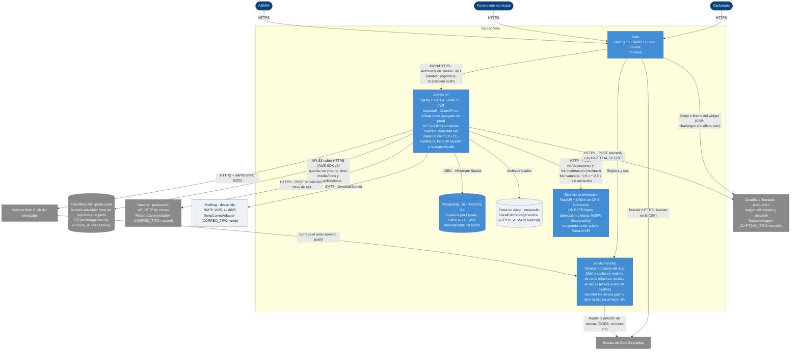

# C4 · Nivel 2: contenedores

> Diagrama **escrito a mano** a partir de `CLAUDE.md`, `ARCHITECTURE.md` (§4.3, §6 y §7) y el código (`application.yml`, `application-prod.yml`, `docker-compose.yml`). `/diagramas` no lo regenera: revísalo cuando aparezca un contenedor o cambie un protocolo. Las cajas claras son lo que solo se usa en desarrollo. Dónde corre cada contenedor en producción: [c4-despliegue.md](c4-despliegue.md).

**Cómo leerlo.** Toda interacción pasa por la PWA, que llama al API con el JWT; el API es el único que escribe en PostgreSQL/PostGIS y el único que habla con el almacén de fotos, el correo y el servicio push. El respaldo diario de la base es el cron `respaldo-bd`, un servicio del despliegue (`c4-despliegue.md`) que no forma parte de la aplicación. Las fotos y el correo entran por un puerto de `common` (`FotoStorageService` y `CorreoSaliente`, §4.3) con dos adaptadores cada uno, elegidos por variable: en producción las fotos van a dos buckets privados de Cloudflare R2 por la API S3 y el correo sale por la API HTTP de Resend; en desarrollo, al disco y a Mailhog por SMTP. El perfil `prod` no arranca sin `FOTOS_ALMACEN`, `CORREO_TIPO`, `CAPTCHA_TIPO`, `CLASIFICACION_TIPO`, `MODERACION_TIPO` ni `ORIGEN_SECRETO`. El registro de cuenta (US-01) verifica el token de Cloudflare Turnstile por el puerto `auth/port/VerificadorDeCaptcha` (NC-08; Turnstile reemplazó a reCAPTCHA v2 en NC-08b, 28/10): en producción contra el `siteverify` de Cloudflare (`CAPTCHA_TIPO=turnstile`); en desarrollo y en los tests, `CAPTCHA_TIPO=ninguno`. La PWA carga el script y el iframe del widget desde `challenges.cloudflare.com` (`script-src`, `frame-src` y `connect-src`, por host), el único origen externo que el captcha suma a su CSP, y su Service Worker nunca cachea ese origen. Con cualquier adaptador las URL de las fotos son las mismas: el API sirve las de reporte en `/media/fotos/reportes/…` (públicas) y las de perfil en `/api/perfiles/fotos/…` (solo a su dueño), así que la PWA nunca habla con R2. Los correos salen después del commit, en el executor asíncrono acotado (D-13). La PWA suscribe el navegador con la clave pública VAPID y registra la suscripción en el API. Cuando cambia el estado de un reporte, el API envía el aviso al servicio push del navegador, que lo entrega al Service Worker para que muestre la notificación (US-21). La cola de reportes sin conexión vive en IndexedDB y la reenvía la página, no el Service Worker (ver `frontend/README.md`). La densidad de reportes (US-11) es pública y la PWA la dibuja como capa de calor en `/mapa`. En producción el Service Worker intercepta las teselas de OpenStreetMap y las repite con `fetch()`; por eso el host de teselas está también en `connect-src` y el mapa las pide con CORS (`frontend/README.md`, sección Mapa). El servicio de inferencia existe desde la v0.8.0 (NC-03a y NC-10a) y solo lo llama el API, con la foto ya saneada, por dos puertos. `clasificacion/infra/InferenciaHttpAdapter` (`/v1/detecciones`) sugiere la categoría (§4.3, D-08); si falla, el reporte queda «sin sugerencia». `moderacion/infra/InferenciaModeracionHttpAdapter` (`/v1/moderacion`) revisa la foto antes de guardarla; si falla al crear un reporte con foto, el API responde 503 (falla cerrada, D-15). Cada adaptador tiene su propio tope de 4 llamadas a la vez. En desarrollo y en los tests, `CLASIFICACION_TIPO=falso` y `MODERACION_TIPO=ninguna` evitan el servicio.
