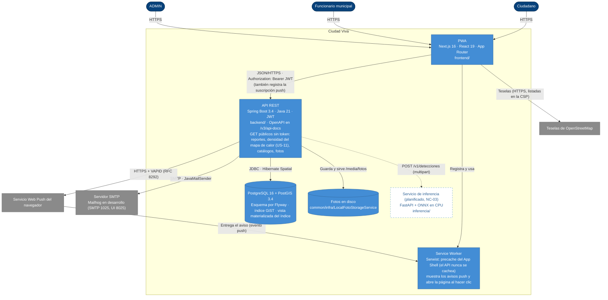

# C4 · Nivel 2: contenedores

> Diagrama **escrito a mano** a partir de `CLAUDE.md`, `ARCHITECTURE.md` (§6 y §7) y el código. `/diagramas` no lo regenera: revísalo cuando aparezca un contenedor o cambie un protocolo. Las líneas punteadas son lo que todavía no existe.

**Cómo leerlo.** Toda interacción pasa por la PWA, que llama al API con el JWT; el API es el único que toca PostgreSQL/PostGIS, el disco de fotos, el SMTP y el servicio push. La PWA suscribe el navegador con la clave pública VAPID y registra la suscripción en el API. Cuando cambia el estado de un reporte, el API envía el aviso al servicio push del navegador, que lo entrega al Service Worker para que muestre la notificación (US-21). La cola de reportes sin conexión vive en IndexedDB y la reenvía la página, no el Service Worker (ver `frontend/README.md`). La densidad de reportes (US-11) es pública; la PWA todavía no la consume. El servicio de inferencia está planificado: el API lo llamará por `clasificacion/infra` para sugerir la categoría de la foto (§4.3, D-08).
