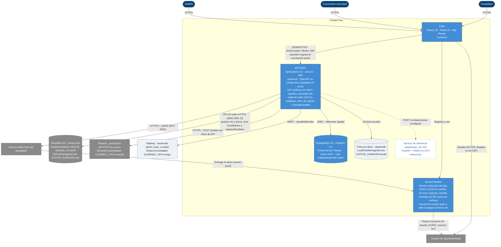

# C4 · Nivel 2: contenedores

> Diagrama **escrito a mano** a partir de `CLAUDE.md`, `ARCHITECTURE.md` (§4.3, §6 y §7) y el código (`application.yml`, `application-prod.yml`, `docker-compose.yml`). `/diagramas` no lo regenera: revísalo cuando aparezca un contenedor o cambie un protocolo. Las líneas punteadas son lo que todavía no existe; las cajas claras, lo que solo se usa en desarrollo. Dónde corre cada contenedor en producción: [c4-despliegue.md](c4-despliegue.md).

**Cómo leerlo.** Toda interacción pasa por la PWA, que llama al API con el JWT; el API es el único que toca PostgreSQL/PostGIS, el almacén de fotos, el correo y el servicio push. Las fotos y el correo entran por un puerto de `common` (`FotoStorageService` y `CorreoSaliente`, §4.3) con dos adaptadores cada uno, elegidos por variable: en producción las fotos van a dos buckets privados de Cloudflare R2 por la API S3 y el correo sale por la API HTTP de Resend; en desarrollo, al disco y a Mailhog por SMTP. El perfil `prod` no arranca sin `FOTOS_ALMACEN` ni `CORREO_TIPO`. Con cualquier adaptador las URL de las fotos son las mismas: el API sirve las de reporte en `/media/fotos/reportes/…` (públicas) y las de perfil en `/api/perfiles/fotos/…` (solo a su dueño), así que la PWA nunca habla con R2. Los correos salen después del commit, en el executor asíncrono acotado (D-13). La PWA suscribe el navegador con la clave pública VAPID y registra la suscripción en el API. Cuando cambia el estado de un reporte, el API envía el aviso al servicio push del navegador, que lo entrega al Service Worker para que muestre la notificación (US-21). La cola de reportes sin conexión vive en IndexedDB y la reenvía la página, no el Service Worker (ver `frontend/README.md`). La densidad de reportes (US-11) es pública y la PWA la dibuja como capa de calor en `/mapa`. En producción el Service Worker intercepta las teselas de OpenStreetMap y las repite con `fetch()`; por eso el host de teselas está también en `connect-src` y el mapa las pide con CORS (`frontend/README.md`, sección Mapa). El servicio de inferencia está planificado: el API lo llamará por `clasificacion/infra` para sugerir la categoría de la foto (§4.3, D-08).
