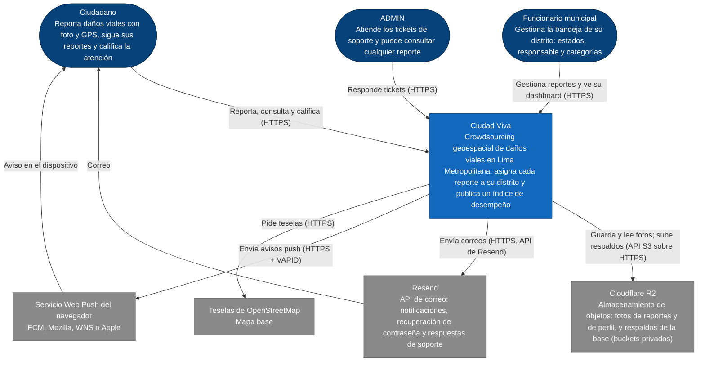

# C4 · Nivel 1: contexto

> Diagrama **escrito a mano** a partir de `CLAUDE.md`, `ARCHITECTURE.md` y el código (`application.yml`, `application-prod.yml`, `next.config.ts`, `docker-compose.yml`). `/diagramas` no lo regenera: revísalo cuando cambie un actor o un sistema externo. Los sistemas externos son los de producción; en desarrollo las fotos van al disco y el correo a Mailhog por SMTP ([c4-contenedores.md](c4-contenedores.md)).

**Cómo leerlo.** Los tres actores usan Ciudad Viva desde el navegador; el sistema depende de cuatro servicios externos: Cloudflare R2 para guardar las fotos y los respaldos de la base, Resend para enviar los correos, el servicio push de cada navegador para los avisos y OpenStreetMap para el mapa base. Los buckets son privados: las fotos se sirven desde el propio sistema, con las mismas URL, y los respaldos solo se suben (restaurarlos es manual, desde el panel de R2: `docs/despliegue.md` §8). El mapa de reportes y el índice de desempeño también son públicos: cualquiera los consulta sin cuenta.
