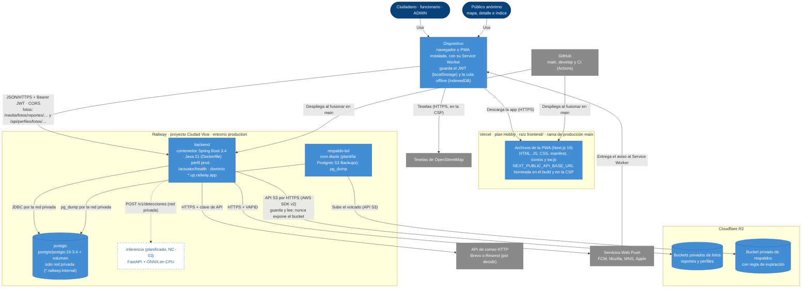

# C4 · Despliegue del MVP

> Diagrama **escrito a mano** a partir de la propuesta `project-context/decisions/propuestas/2026-10-21-despliegue-mvp.md` (estado: abierta) y del runbook `docs/despliegue.md`. `/diagramas` no lo regenera: revísalo cuando cambie un proveedor, un servicio de Railway o la forma de servir las fotos. Las líneas y cajas punteadas son lo que todavía no existe.

**Cómo leerlo.** La PWA corre en el **dispositivo** de cada persona (navegador o app instalada, con su Service Worker). Vercel solo le entrega los archivos estáticos de la app; las llamadas al API, las teselas de OpenStreetMap y los avisos push van directo entre el dispositivo y cada servicio. El dispositivo habla con el API en Railway con el JWT. El API es el único que toca la base PostGIS, que no tiene puerto público y se alcanza por la red privada de Railway, y el único que tiene credenciales de R2: los buckets son privados y el API sirve las fotos con las mismas URLs de hoy, públicas las de reporte y solo para su dueño las de perfil, así que ni el contrato ni la CSP cambian. El correo sale por la API HTTP de un proveedor (Railway Hobby bloquea el SMTP saliente). Los avisos push van del API al servicio push de cada navegador, que los entrega al Service Worker del dispositivo. Un servicio cron de Railway hace cada noche un `pg_dump` por la red privada y lo guarda en un bucket de respaldos separado. Vercel y Railway despliegan solos al fusionar en `main` (las versiones etiquetadas); la CI de GitHub corre las pruebas en cada PR. El servicio de inferencia está planificado (NC-03) y viviría en la misma red privada.
