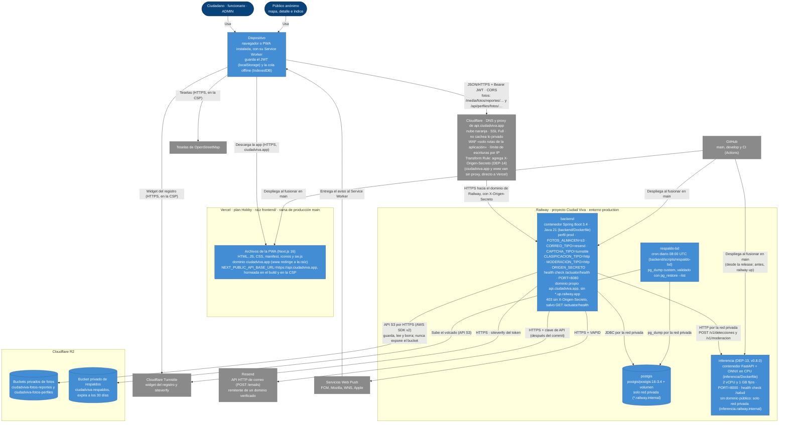

# C4 · Despliegue del MVP

> Diagrama **escrito a mano** a partir de las propuestas aceptadas el 21/10 (`project-context/decisions/propuestas/2026-10-21-despliegue-mvp.md`, `2026-10-21-fotos-r2.md` y `2026-10-21-correo-saliente-http.md`), del runbook `docs/despliegue.md` y del código (`application-prod.yml`, `backend/Dockerfile`). `/diagramas` no lo regenera: revísalo cuando cambie un proveedor, un servicio de Railway o la forma de servir las fotos. Refleja la v0.8.0: el servicio `inferencia` (DEP-13), Turnstile (NC-08b) y el encabezado de origen (DEP-14).

**Cómo leerlo.** La PWA corre en el **dispositivo** de cada persona (navegador o app instalada, con su Service Worker). Vercel solo le entrega los archivos estáticos de la app, desde `ciudadviva.app`, el único origen de la PWA. Las teselas de OpenStreetMap y los avisos push van directo entre el dispositivo y cada servicio. Las llamadas al API, en cambio, pasan por el proxy de Cloudflare de `api.ciudadviva.app` (decisión 3b; SSL Full, porque el modo estricto no funciona con Railway). Por eso la prueba de humo revisa que Cloudflare no cachee la foto de perfil ni otra respuesta privada (runbook §7.3, punto 16). El dispositivo habla con el API en Railway con el JWT. El API es el único que escribe en la base PostGIS, que no tiene puerto público y se alcanza por la red privada de Railway (el cron `respaldo-bd` solo la lee con `pg_dump`), y el único con credenciales de los buckets de fotos (`FOTOS_S3_*`, token de fotos; `respaldo-bd` usa su propio token, limitado a `ciudadviva-respaldos`): los buckets son privados y el API sirve las fotos con las mismas URLs de desarrollo, públicas las de reporte y solo para su dueño las de perfil, así que ni el contrato ni la CSP cambian. El correo sale por la API HTTP de Resend (`CORREO_API_KEY`), porque Railway Hobby bloquea el SMTP saliente; se envía después del commit, en el executor asíncrono del API. En el perfil `prod`, `FOTOS_ALMACEN`, `CORREO_TIPO` y `CAPTCHA_TIPO` son obligatorias: sin ellas el API no arranca, para que un despliegue nunca guarde fotos en el disco efímero del contenedor, ni intente un SMTP bloqueado, ni publique el registro sin haber decidido el captcha (NC-08; desde NC-08b el registro verifica el token de Cloudflare Turnstile contra su `siteverify`, fuera de la transacción, y con `CAPTCHA_TIPO=ninguno` se apaga a propósito). Railway solo consulta `/actuator/health` al desplegar, para cambiar de versión sin corte (responde `{"status":"UP"}` sin detalles), y su configuración vive en el panel, sin `railway.toml` (runbook §0). Los avisos push van del API al servicio push de cada navegador, que los entrega al Service Worker del dispositivo. Un servicio cron de Railway hace cada noche un `pg_dump` por la red privada y lo guarda en un bucket de respaldos separado. Vercel y Railway despliegan solos al fusionar en `main` (las versiones etiquetadas); la CI de GitHub corre las pruebas en cada PR.

**Desde la v0.8.0.** Cloudflare, además del WAF y del límite de escrituras por IP, agrega a cada petición hacia `api.ciudadviva.app` el encabezado `X-Origen-Secreto` con una *Transform Rule*. El `backend` responde 403 a lo que no lo trae (DEP-14). Así nadie se salta el proxy pidiendo directo a la IP de Railway con `Host: api.ciudadviva.app` (SEC-05). La única excepción es `GET /actuator/health`, porque el *health check* de Railway entra directo. El registro muestra el widget de Cloudflare Turnstile en el dispositivo, y el `backend` verifica su token con `siteverify` antes de crear la cuenta (NC-08b). El servicio `inferencia` vive en la misma red privada, sin dominio público, y solo lo llama el `backend`: sugiere la categoría de la foto (`/v1/detecciones`) y la revisa antes de guardarla (`/v1/moderacion`). Si no responde, la sugerencia queda vacía, pero un reporte con foto recibe 503 (falla cerrada, D-15). Hasta la release se sube con `railway up`; después despliega desde `main`, como el `backend` (runbook §5.4 y §10.1).
