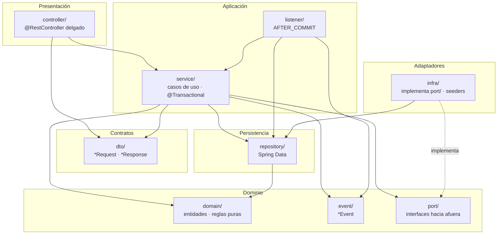
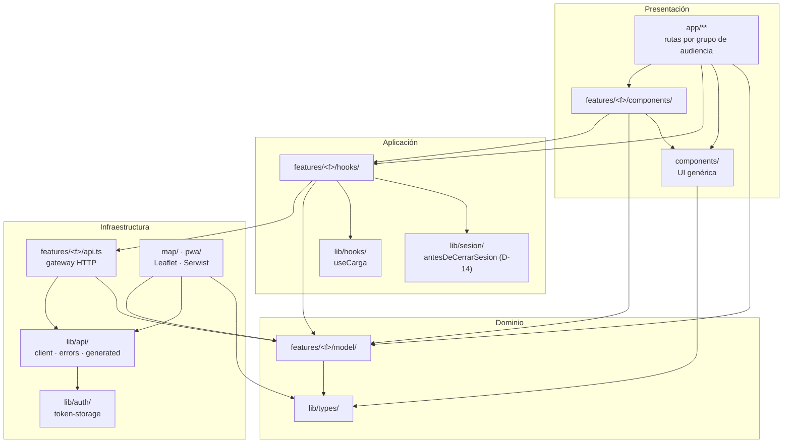
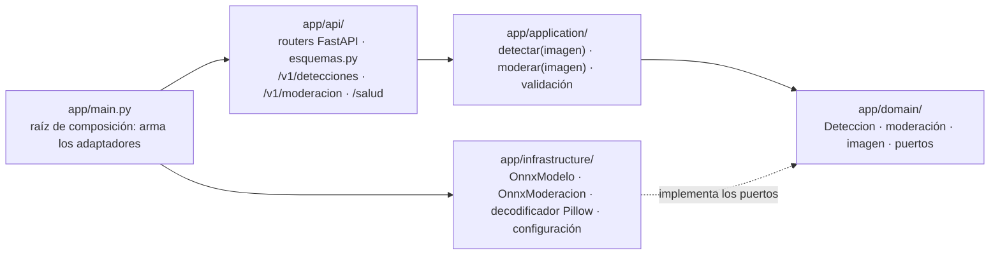

# Capas

> Diagramas **escritos a mano** a partir de `ARCHITECTURE.md` §2–§6 (versión 1.7). Muestran la **norma**, no el código: lo que el código hace de verdad está en [modulos.md](modulos.md), que se regenera. Si la norma cambia, se actualizan aquí en la misma rama de `/diagramas`.

Las mismas cuatro capas en todos los contenedores: presentación, aplicación, dominio e infraestructura, más la capa de contratos que comparten presentación y aplicación. Las dependencias apuntan hacia el dominio.

## Backend (dentro de cada módulo `pe.edu.upc.viasegura.<modulo>`)

**Cómo leerlo.** Una flecha es «puede usar». La presentación entra por la aplicación, la aplicación usa los repositorios directamente (D-04) y la infraestructura externa solo a través de un `port/`; nadie referencia una clase de `infra/`: Spring inyecta la implementación por la interfaz. De **otro** módulo solo se usa su API pública (`service`, `domain`, `event`, `port`, `dto`); lo verifica `ArquitecturaCapasTest` (§4.4).

## Frontend (`frontend/src/`)

**Cómo leerlo.** Las rutas solo componen: nunca importan `api.ts` ni `lib/api`. Cada feature llama al API únicamente desde su `api.ts`, los hooks orquestan y `model/` es puro. De **otra** feature solo se importa su `model/`; lo que comparten dos features va a `lib/`. `lib/sesion/` coordina los pasos que una feature registra y `auth` ejecuta antes de cerrar la sesión, sin que `auth` conozca a esa feature (D-14). Lo verifica `eslint.capas.mjs` (§5.4).

## Inferencia (`inferencia/`)

**Cómo leerlo.** La aplicación invoca los dos modelos por interfaces del dominio (`domain/puertos.py`, principio 4 de §1), y la infraestructura las implementa con onnxruntime y Pillow; el dominio y la aplicación no conocen ninguna librería de terceros. `app/main.py` arma los adaptadores y se los pasa a los routers, así que la presentación nunca importa la infraestructura. El servicio solo mide: el umbral y la clase dominante de la sugerencia se aplican en el backend (`clasificacion/domain`), y el umbral de la moderación también (`moderacion/domain/PoliticaDeModeracion`, D-15). Lo verifica import-linter (`inferencia/pyproject.toml`): el contrato de capas `main > api > application | infrastructure > domain`, exhaustivo, y dos contratos que prohíben a la presentación usar la infraestructura y al dominio y la aplicación usar librerías de terceros (§6).
