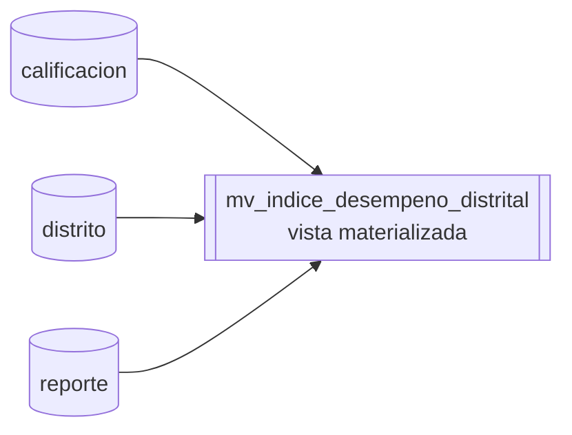

# Modelo de datos

> Lo que está entre los marcadores `generado` lo escribe `/diagramas` aplicando en orden las migraciones Flyway (`backend/src/main/resources/db/migration/V*.sql`); **no se edita a mano**. El texto fuera de los marcadores es manual.

**Cómo leerlo.** Cada entidad muestra solo sus columnas clave: la PK, las FK, las únicas (`UK`), las que tienen un `CHECK … IN` (con sus valores) y las geográficas de PostGIS; la tabla de debajo da el total de columnas y en qué migración nació y cambió cada tabla. En las relaciones, `||` es una FK obligatoria y `|o` una que admite `NULL`; `o{` son muchas filas por cada padre y `o|` como máximo una.

`categoria_dano` y `usuario` son catálogos que los tests de integración no limpian; toda tabla nueva con FK a `reporte` debe entrar en `AbstractPostgisIT.limpiezaFkSafe()` (`CLAUDE.md`). Las vistas materializadas se dibujan aparte porque no tienen FK: se recalculan desde sus tablas de origen con `REFRESH MATERIALIZED VIEW CONCURRENTLY` (listener `IndiceDesempenoRefreshListener`).

<!-- generado:inicio modelo-datos -->
<!-- No editar a mano: lo regenera /diagramas (.claude/skills/diagramas/modelo-datos.mjs). -->

Esquema que resulta de aplicar 18 migraciones (V1, V2, V3, V4, V5, V6, V7, V8, V9, V10, V11, V12, V13, V14, V15, V16, V17, V18).

## Tablas

```mermaid
erDiagram
  adhesion_reporte {
    bigint id PK
    bigint reporte_id FK
    bigint usuario_id FK
  }
  asignacion_responsable {
    bigint id PK
    bigint reporte_id FK
    bigint asignado_por_id FK "nullable"
  }
  calificacion {
    bigint id PK
    bigint reporte_id FK
    bigint usuario_id FK
  }
  categoria_dano {
    bigint id PK
    bigint distrito_id FK "nullable"
  }
  comentario_publico {
    bigint id PK
    bigint reporte_id FK
    bigint usuario_id FK
  }
  consentimiento {
    bigint id PK
    bigint usuario_id FK
    varchar finalidad "TERMINOS_Y_PRIVACIDAD, NOTIFICACIONES_PUSH, NOTIFICACIONES_CORREO"
  }
  distrito {
    bigint id PK
    varchar nombre UK
    geography limites "MultiPolygon, 4326 · nullable"
  }
  historial_estado_reporte {
    bigint id PK
    bigint reporte_id FK
    bigint autor_id FK "nullable"
    varchar tipo_evento "CAMBIO_ESTADO, ASIGNACION"
  }
  idempotency_key {
    bigint id PK
    bigint usuario_id FK
  }
  municipalidad {
    bigint id PK
    bigint distrito_id FK, UK
    varchar nombre UK
  }
  notificacion {
    bigint id PK
    bigint usuario_id FK
    bigint reporte_id FK "nullable"
    varchar canal "PUSH, EMAIL"
    varchar estado_entrega "PENDIENTE, ENVIADA, FALLIDA"
  }
  password_reset_token {
    bigint id PK
    bigint usuario_id FK
    varchar token UK
  }
  periodo_gestion {
    bigint id PK
    date fecha_inicio UK
  }
  reporte {
    bigint id PK
    geography ubicacion "Point, 4326"
    bigint categoria_id FK
    varchar estado "PENDIENTE, RECIBIDO, EN_PROCESO, RESUELTO, RECHAZADO, CANCELADO"
    bigint distrito_id FK "nullable"
    bigint creador_id FK
    varchar severidad "BAJA, MEDIA, ALTA"
    bigint periodo_gestion_id FK "nullable"
  }
  suscripcion_push {
    bigint id PK
    bigint usuario_id FK
    text endpoint UK
  }
  ticket_soporte {
    bigint id PK
    bigint usuario_id FK "nullable"
    varchar estado "ABIERTO, EN_PROCESO, CERRADO"
  }
  usuario {
    bigint id PK
    varchar email UK
    varchar rol "CIUDADANO, FUNCIONARIO_MUNICIPAL, ADMIN"
    bigint distrito_id FK "nullable"
  }
  categoria_dano ||--o{ reporte : "categoria_id"
  distrito |o--o{ categoria_dano : "distrito_id"
  distrito |o--o{ reporte : "distrito_id"
  distrito |o--o{ usuario : "distrito_id"
  distrito ||--o| municipalidad : "distrito_id"
  periodo_gestion |o--o{ reporte : "periodo_gestion_id"
  reporte |o--o{ notificacion : "reporte_id"
  reporte ||--o{ adhesion_reporte : "reporte_id"
  reporte ||--o{ asignacion_responsable : "reporte_id"
  reporte ||--o{ calificacion : "reporte_id"
  reporte ||--o{ comentario_publico : "reporte_id"
  reporte ||--o{ historial_estado_reporte : "reporte_id"
  usuario |o--o{ asignacion_responsable : "asignado_por_id"
  usuario |o--o{ historial_estado_reporte : "autor_id"
  usuario |o--o{ ticket_soporte : "usuario_id"
  usuario ||--o{ adhesion_reporte : "usuario_id"
  usuario ||--o{ calificacion : "usuario_id"
  usuario ||--o{ comentario_publico : "usuario_id"
  usuario ||--o{ consentimiento : "usuario_id"
  usuario ||--o{ idempotency_key : "usuario_id"
  usuario ||--o{ notificacion : "usuario_id"
  usuario ||--o{ password_reset_token : "usuario_id"
  usuario ||--o{ reporte : "creador_id"
  usuario ||--o{ suscripcion_push : "usuario_id"
```

| Tabla | Columnas | Unicidad compuesta o parcial | Creada en | Modificada en |
|---|---|---|---|---|
| `adhesion_reporte` | 4 | (reporte_id, usuario_id) | V1 | — |
| `asignacion_responsable` | 7 | — | V1 | — |
| `calificacion` | 6 | (reporte_id, usuario_id) | V1 | — |
| `categoria_dano` | 6 | — | V1 | — |
| `comentario_publico` | 6 | — | V1 | — |
| `consentimiento` | 6 | (usuario_id, finalidad, version_documento) parcial | V13 | — |
| `distrito` | 4 | — | V1 | — |
| `historial_estado_reporte` | 8 | — | V1 | V4 |
| `idempotency_key` | 6 | (clave, usuario_id) | V11 | — |
| `municipalidad` | 4 | — | V15 | — |
| `notificacion` | 10 | — | V1 | — |
| `password_reset_token` | 6 | — | V8 | — |
| `periodo_gestion` | 3 | — | V15 | V16 |
| `reporte` | 16 | — | V1 | V6, V7, V17 |
| `suscripcion_push` | 9 | — | V12 | — |
| `ticket_soporte` | 9 | — | V1 | V9 |
| `usuario` | 12 | — | V1 | V10 |

## Vistas

| Vista | Columnas | Tablas de origen | Migraciones |
|---|---|---|---|
| `mv_indice_desempeno_distrital` | `id`, `distrito_id`, `distrito_nombre`, `categoria_id`, `total_reportes`, `total_resueltos`, `tasa_resolucion`, `tiempo_promedio_horas`, `satisfaccion_promedio`, `total_calificaciones`, `calculated_at` | `calificacion`, `distrito`, `reporte` | V2, V5, V7 |
<!-- generado:fin modelo-datos -->
