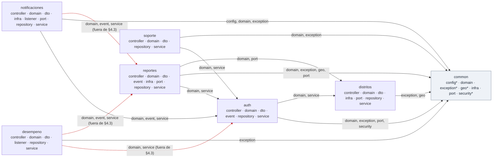
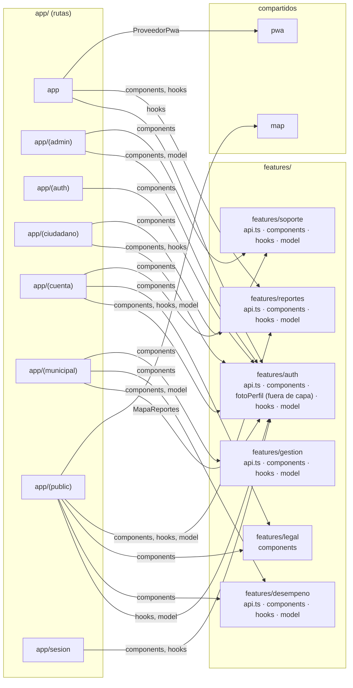
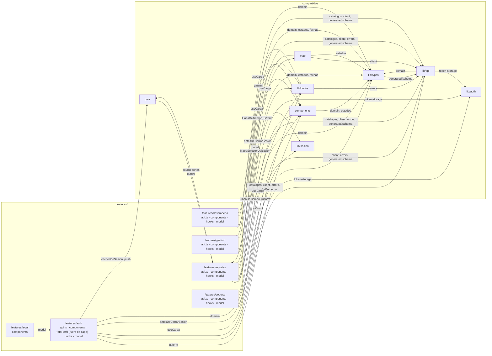

# Módulos y dependencias

> Lo que está entre los marcadores `generado` lo escribe `/diagramas` a partir del código; **no se edita a mano** (se pierde en la siguiente corrida). El texto fuera de los marcadores es manual.

Estos diagramas muestran el código **como es**, no como debería ser. Cuando una dependencia real no coincide con `ARCHITECTURE.md`, se dibuja igual, punteada y en rojo, y se lista debajo. No se corrige en el dibujo: si hay que cambiar la norma o el código, se registra con `/propuesta`.

## Backend: módulos de `pe.edu.upc.viasegura`

**Cómo leerlo.** Cada caja es un módulo con sus subpaquetes; una flecha `A → B` significa que alguna clase de `A` importa algo de `B`, y la etiqueta dice de qué subpaquetes de `B`. La comparación es con la tabla de §4.3 («Usa a») y con la regla de API pública: de otro módulo solo `service`, `domain`, `event`, `port` y `dto`. `common` es transversal: cualquier módulo puede usarlo y él no usa a ninguno. La guarda oficial es `ArquitecturaCapasTest` (ArchUnit); este diagrama solo mira los `import`.

<!-- generado:inicio modulos-backend -->
<!-- No editar a mano: lo regenera /diagramas (.claude/skills/diagramas/modulos-backend.mjs). -->

| Origen | Destino | Subpaquetes usados | ¿Prevista en §4.3? |
|---|---|---|---|
| `auth` | `common` | `domain`, `exception`, `port`, `security` | sí (common es transversal) |
| `auth` | `distritos` | `domain`, `service` | sí |
| `desempeno` | `auth` | `domain`, `service` | **no** |
| `desempeno` | `common` | `exception` | sí (common es transversal) |
| `desempeno` | `reportes` | `domain`, `event`, `service` | **no** |
| `distritos` | `common` | `exception`, `geo` | sí (common es transversal) |
| `notificaciones` | `auth` | `domain`, `event`, `service` | sí |
| `notificaciones` | `common` | `config`, `domain`, `exception` | sí (common es transversal) |
| `notificaciones` | `reportes` | `domain`, `event`, `service` | **no** |
| `reportes` | `auth` | `domain`, `service` | sí |
| `reportes` | `common` | `domain`, `exception`, `geo`, `port` | sí (common es transversal) |
| `reportes` | `distritos` | `domain`, `port` | sí |
| `soporte` | `auth` | `domain`, `service` | sí |
| `soporte` | `common` | `domain`, `exception` | sí (common es transversal) |

Subpaquetes marcados con `*`: fuera de la lista estándar de §4.1. `common`: `config`, `exception`, `geo`, `security`.

Módulos de §4.3 que todavía no existen en el código: `clasificacion` (nuevo), `municipalidades` (nuevo).

**Diferencias con §4.3** (se dibujan como son; si hay que cambiar la norma o el código, `/propuesta`):

- `desempeno` → `auth`: §4.3 no prevé que desempeno use a auth.
- `desempeno` → `reportes`: §4.3 limita desempeno → reportes a event y usa domain (desempeno/listener/IndiceDesempenoRefreshListener.java).
- `desempeno` → `reportes`: §4.3 limita desempeno → reportes a event y usa service (desempeno/service/DesempenoService.java).
- `notificaciones` → `reportes`: §4.3 limita notificaciones → reportes a event y usa domain (notificaciones/domain/Notificacion.java, notificaciones/service/NotificacionService.java).
- `notificaciones` → `reportes`: §4.3 limita notificaciones → reportes a event y usa service (notificaciones/service/NotificacionService.java).
<!-- generado:fin modulos-backend -->

## Frontend: features, compartidos y rutas

**Cómo leerlo.** El primer diagrama muestra qué features y compartidos usa cada grupo de rutas de `app/`; el segundo, cómo se relacionan las features con `lib/`, `map/`, `pwa/` y `components/`. La etiqueta de una flecha hacia una feature dice qué capa usa (`components`, `hooks`, `model`, `api.ts`); hacia un compartido, qué archivo. No se cuentan los tests ni los tipos generados, ni los imports dentro de una misma feature. La medición oficial de capas es la de `eslint.capas.mjs` (`/verificar`).

<!-- generado:inicio features-frontend -->
<!-- No editar a mano: lo regenera /diagramas (.claude/skills/diagramas/features-frontend.mjs). -->

### Rutas (app/) hacia features y compartidos

### Features y compartidos

| Origen | Destino | Qué usa | ¿Permitido por §5? |
|---|---|---|---|
| `app` | `features/auth` | `hooks` | sí |
| `app` | `features/reportes` | `components`, `hooks` | sí |
| `app` | `pwa` | `ProveedorPwa` | sí |
| `app/(admin)` | `features/auth` | `components`, `model` | sí |
| `app/(admin)` | `features/soporte` | `components` | sí |
| `app/(auth)` | `features/auth` | `components` | sí |
| `app/(ciudadano)` | `features/auth` | `components`, `hooks` | sí |
| `app/(ciudadano)` | `features/reportes` | `components` | sí |
| `app/(cuenta)` | `features/auth` | `components`, `hooks`, `model` | sí |
| `app/(cuenta)` | `features/legal` | `components` | sí |
| `app/(cuenta)` | `features/soporte` | `components` | sí |
| `app/(municipal)` | `features/auth` | `components`, `model` | sí |
| `app/(municipal)` | `features/desempeno` | `components` | sí |
| `app/(municipal)` | `features/gestion` | `components` | sí |
| `app/(public)` | `features/auth` | `hooks`, `model` | sí |
| `app/(public)` | `features/desempeno` | `components` | sí |
| `app/(public)` | `features/legal` | `components` | sí |
| `app/(public)` | `features/reportes` | `components`, `hooks`, `model` | sí |
| `app/(public)` | `map` | `MapaReportes` | sí |
| `app/sesion` | `features/auth` | `components`, `hooks` | sí |
| `components` | `lib/types` | `domain`, `estados` | sí |
| `features/auth` | `components` | `ui/form` | sí |
| `features/auth` | `lib/api` | `catalogos`, `client`, `errors`, `generated/schema` | sí |
| `features/auth` | `lib/auth` | `token-storage` | sí |
| `features/auth` | `lib/hooks` | `useCarga` | sí |
| `features/auth` | `lib/sesion` | `antesDeCerrarSesion` | sí |
| `features/auth` | `lib/types` | `domain` | sí |
| `features/auth` | `pwa` | `cachesDeSesion`, `push` | sí |
| `features/desempeno` | `components` | `ui/form` | sí |
| `features/desempeno` | `lib/api` | `catalogos`, `client`, `generated/schema` | sí |
| `features/desempeno` | `lib/hooks` | `useCarga` | sí |
| `features/desempeno` | `lib/types` | `domain` | sí |
| `features/gestion` | `components` | `LineaDeTiempo`, `ui/form` | sí |
| `features/gestion` | `lib/api` | `catalogos`, `client`, `errors`, `generated/schema` | sí |
| `features/gestion` | `lib/hooks` | `useCarga` | sí |
| `features/gestion` | `lib/types` | `domain`, `estados`, `fechas` | sí |
| `features/legal` | `features/auth` | `model` | sí |
| `features/reportes` | `components` | `LineaDeTiempo`, `ui/form` | sí |
| `features/reportes` | `lib/api` | `catalogos`, `client`, `errors`, `generated/schema` | sí |
| `features/reportes` | `lib/auth` | `token-storage` | sí |
| `features/reportes` | `lib/hooks` | `useCarga` | sí |
| `features/reportes` | `lib/sesion` | `antesDeCerrarSesion` | sí |
| `features/reportes` | `lib/types` | `domain`, `estados`, `fechas` | sí |
| `features/reportes` | `map` | `MapaSelectorUbicacion` | sí |
| `features/reportes` | `pwa` | `colaReportes` | sí |
| `features/soporte` | `components` | `ui/form` | sí |
| `features/soporte` | `lib/api` | `client`, `errors`, `generated/schema` | sí |
| `features/soporte` | `lib/hooks` | `useCarga` | sí |
| `features/soporte` | `lib/types` | `domain` | sí |
| `lib/api` | `lib/auth` | `token-storage` | sí |
| `lib/api` | `lib/types` | `domain` | sí |
| `lib/hooks` | `lib/api` | `errors` | sí |
| `lib/types` | `lib/api` | `generated/schema` | sí |
| `map` | `features/reportes` | `model` | sí |
| `map` | `lib/api` | `client` | sí |
| `map` | `lib/types` | `estados` | sí |
| `pwa` | `features/reportes` | `model` | sí |

**Diferencias con §5** (se dibujan como son; la cifra oficial es la de `eslint.capas.mjs` en `/verificar`):

- `features/auth/fotoPerfil.ts` está fuera de components/, hooks/, model/ y api.ts (§5.1).
<!-- generado:fin features-frontend -->
